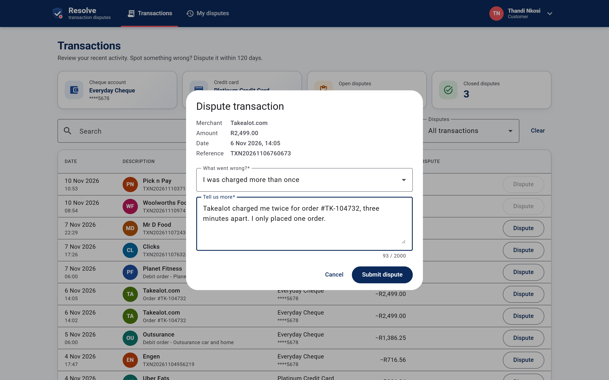
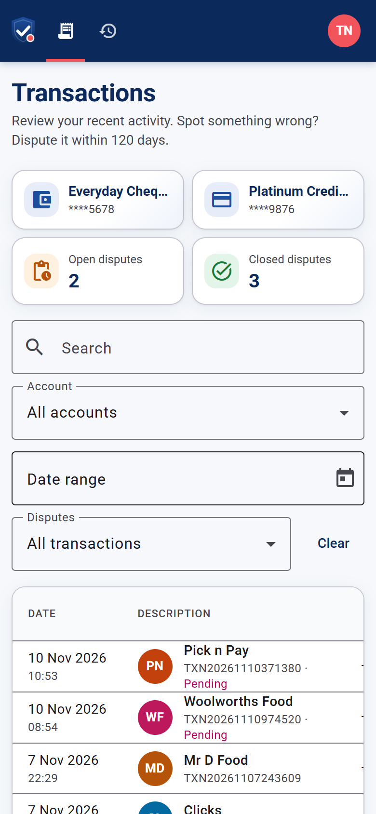

<p align="center">
  
</p>

<h1 align="center">Resolve: transaction disputes</h1>

<p align="center"><em>Built for the Capitec Software Engineer assessment.</em></p>

Bank customers can **view their transactions**, **dispute** the ones that look wrong, and follow the **full history of
every dispute**. Back-office **agents** work the dispute queue (start review, uphold, decline).

.NET 10 Web API · Angular 21 · PostgreSQL 17 · one Docker image (the API serves the web app)


---

## Requirements

You only need **Docker**:

| Your machine     | Install                                                                                                 |
| ---------------- | ------------------------------------------------------------------------------------------------------- |
| Windows or macOS | [Docker Desktop](https://www.docker.com/products/docker-desktop/), started and running                   |
| Linux            | [Docker Engine](https://docs.docker.com/engine/install/) with the [Compose plugin](https://docs.docker.com/compose/install/linux/) (v2) |

You **do not** need .NET, Node.js or PostgreSQL installed. Docker builds the app and runs its own PostgreSQL
database in a container. Port **8080** must be free.

Check Docker is ready with `docker compose version`. It should print a version, not an error.

## Run it

```bash
git clone https://github.com/Reubza/tdp-transactions-dispute-portal.git
cd tdp-transactions-dispute-portal
docker compose up --build
```

Open **http://localhost:8080** once the log shows a line containing `Now listening on`. The first build takes a few
minutes because it downloads and compiles everything. Later starts take seconds.

On first start the app creates the database tables and loads demo data automatically. Sign in with:

| Who               | E-mail               | Password    | What they can do                                                         |
| ----------------- | -------------------- | ----------- | ------------------------------------------------------------------------ |
| Customer          | `thandi@example.com` | `Demo@1234` | 2 accounts, ~115 transactions, disputes in every state                   |
| Customer          | `james@example.com`  | `Demo@1234` | 1 account, one open dispute                                              |
| Back-office agent | `agent@example.com`  | `Demo@1234` | Sees every customer's disputes and resolves them                         |

Interactive API docs are at **http://localhost:8080/scalar**.

### Stop and reset

| To                                      | Run                                       |
| --------------------------------------- | ----------------------------------------- |
| Stop the app                            | `Ctrl+C`, or `docker compose down`        |
| Start again (keeps your data)           | `docker compose up`                       |
| Start fresh with the original demo data | `docker compose down -v`, then `docker compose up` |

<details>
<summary><strong>Five-minute demo walkthrough</strong></summary>

The demo data contains a realistic case: Takealot charged order **#TK-104732** (R2,499.00) twice, three minutes
apart, on Thandi's cheque account.

1. **Sign in as Thandi.** The overview shows her two accounts and her open and closed disputes.
2. **Spot the problem.** Search for `TK-104732`: two identical Takealot charges appear.
3. **Dispute it.** Click *Dispute* on the second charge, choose *I was charged more than once*, explain, and submit.
   The row now shows *Submitted* and can't be disputed again.
4. **See it in history.** Open *My disputes*. The new dispute sits alongside past ones: upheld, declined, withdrawn
   and under review.
5. **Switch to the agent** (sign out, then `agent@example.com`). Open Thandi's dispute, click *Start review* and add a note.
6. **Resolve it.** Click *Uphold* with a resolution note. The dispute is now closed.
7. **Back as Thandi**, open the dispute: the timeline shows each step, who made it and when.

Also worth showing:
- **No second dispute after a refund.** A transaction whose dispute was upheld can't be disputed again. Hover the
  disabled button for the reason.
- **One appeal after a decline.** Thandi's recently declined dispute shows an *Appeal* button. She can appeal once,
  within 30 days of the decision, and a declined appeal is final.
- Transactions older than 120 days, pending ones and salary credits can't be disputed, and James can't see Thandi's
  disputes.

<table>
  <tr>
    <td></td>
    <td></td>
  </tr>
  <tr>
    <td></td>
    <td></td>
  </tr>
</table>

</details>

## Test it

**With Docker only.** This runs the backend unit tests, the frontend tests and the formatting check inside Docker:

```bash
docker build --target test .
```

The command succeeds only if every test passes.

**The full suite**, including integration tests that call the real API over HTTP against a real PostgreSQL, needs the
[.NET 10 SDK](https://dotnet.microsoft.com/download) and [Node.js 22.12+](https://nodejs.org/) as well as Docker. The
integration tests start their own throwaway PostgreSQL container:

```bash
dotnet test                       # backend unit + integration tests

cd web
npm ci
npm run test:ci                   # frontend tests
npm run format:check
npm run build
```

All of this runs in GitHub Actions on every push ([.github/workflows/ci.yml](.github/workflows/ci.yml)).

## Build and run the Docker image on its own

The [`Dockerfile`](Dockerfile) builds the whole system into one small, non-root image with a health check:

```bash
docker build -t resolve .
```

The image needs a PostgreSQL database, passed in as configuration. The easiest one to use is the database from
`docker-compose.yml`:

```bash
docker compose up -d db

docker run --rm -p 8080:8080 --network dispute-portal_default \
  -e ConnectionStrings__DisputePortal="Host=db;Database=dispute_portal;Username=dispute_portal;Password=dispute_portal" \
  -e Jwt__SigningKey="replace-with-a-random-secret-of-32-or-more-characters" \
  -e Database__MigrateOnStartup=true \
  -e Database__Seed__Enabled=true \
  -e Database__Seed__DemoPassword="Demo@1234" \
  resolve
```

To use your own PostgreSQL server instead, drop `--network` and set `Host=` to that server (from inside a container,
your own machine is `host.docker.internal`). In Windows PowerShell, replace each trailing `\` with a backtick (`` ` ``).

If the database can't be reached, the app retries for 30 seconds and then stops with a message saying what to do. It
never prints the password.

## Troubleshooting

| Problem                                                                    | Fix                                                                                                    |
| -------------------------------------------------------------------------- | ------------------------------------------------------------------------------------------------------ |
| `Cannot connect to the Docker daemon` / `dockerDesktopLinuxEngine` errors   | Docker Desktop isn't running. Start it and wait until it says *Engine running*.                         |
| Docker Desktop on Windows asks for WSL 2                                    | Run `wsl --install` in an administrator terminal, restart, then start Docker Desktop.                   |
| `port is already allocated` on 8080                                        | Use another port: `APP_PORT=8081 docker compose up` (PowerShell: `$env:APP_PORT=8081; docker compose up`) and open http://localhost:8081. |
| `Cannot connect to PostgreSQL at …` in the log                             | Running the image on its own without a database. Use `docker compose up --build`, or see the section above. |
| Sign-in fails with the demo passwords                                      | The database was seeded with a different `DEMO_PASSWORD`. Reset it with `docker compose down -v`.      |
| Anything else odd                                                          | Rebuild from scratch: `docker compose down -v` then `docker compose up --build`.                       |

Every setting can be overridden through a `.env` file. Copy [`.env.example`](.env.example) to `.env` and edit it.

## Developing locally

To work on the code with hot reload, install the [.NET 10 SDK](https://dotnet.microsoft.com/download) and
[Node.js 22.12+](https://nodejs.org/). You still don't need to install PostgreSQL:

```bash
docker compose up -d db            # PostgreSQL on localhost:5433 (the API's Development settings point here)
dotnet run --project src/Api       # API on http://localhost:5080, creates and seeds the database

cd web
npm ci
npm start                          # web app on http://localhost:4200, proxies /api to the API
```

## How it's built

Clean architecture (Domain → Application → Infrastructure → Api), with business rules enforced in the domain and backed
by database constraints, JWT auth with role policies, RFC 9457 error responses, structured logging and health checks.

See **[docs/ARCHITECTURE.md](docs/ARCHITECTURE.md)** for features, business rules, the API, configuration, security
and production-readiness notes, and trade-offs.
