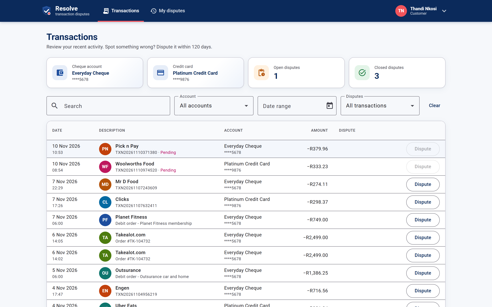
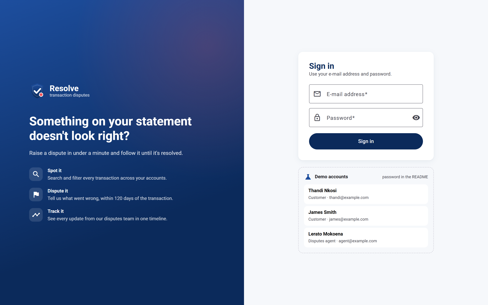
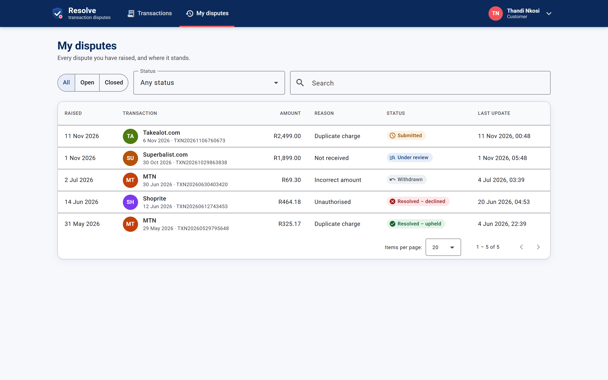
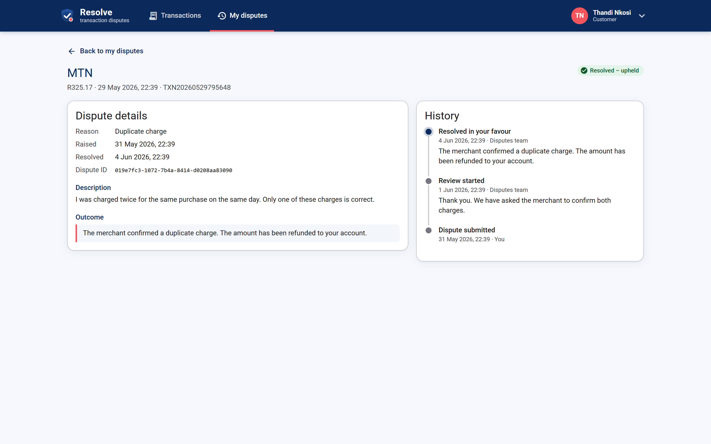
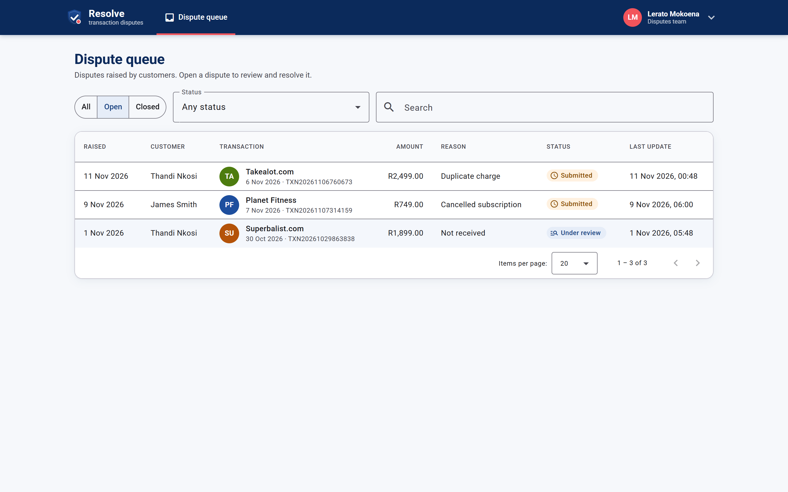

<p align="center">
  
</p>

<h1 align="center">Resolve — transaction disputes</h1>

<p align="center"><em>Built for the Capitec Software Engineer assessment.</em></p>

A full-stack web application where bank customers can **view their transactions**, **dispute** the ones that look wrong,
and follow **the full history of every dispute** they have raised. A back-office **agent** view lets the bank work the
dispute queue (start review, uphold, decline), so the customer's history reflects a real lifecycle.

- **Backend:** .NET 10 / ASP.NET Core Web API, EF Core 10, PostgreSQL 17, JWT bearer auth
- **Frontend:** Angular 21 (standalone components, signals, Angular Material 3)
- **Delivery:** a single multi-stage `Dockerfile` (API serves the SPA), `docker-compose.yml` with PostgreSQL, GitHub Actions CI



<details>
<summary><strong>More screenshots</strong></summary>

| Sign in | Raise a dispute |
| --- | --- |
|  |  |
| **Dispute history** | **Dispute timeline** |
|  |  |
| **Agent queue** | **Mobile** |
|  |  |

</details>

---

## Quick start (Docker)

Requires Docker with Docker Compose v2.

```bash
docker compose up --build
```

Then open **http://localhost:8080**.

| Who                 | E-mail               | Password    | What they can do                                     |
| ------------------- | -------------------- | ----------- | ---------------------------------------------------- |
| Customer            | `thandi@example.com` | `Demo@1234` | 2 accounts, ~115 transactions incl. debit orders, disputes in every state |
| Customer            | `james@example.com`  | `Demo@1234` | 1 account, one open dispute                          |
| Back-office agent   | `agent@example.com`  | `Demo@1234` | Sees every customer's disputes and resolves them      |

On startup the container applies database migrations and seeds the demo data into an empty database (both are
controlled by configuration, see below). Interactive API docs are at **http://localhost:8080/scalar** and the OpenAPI
document at `/openapi/v1.json`.

To stop and remove the data volume: `docker compose down -v`. Run that before a demo to start from fresh seed data.

### Demo walkthrough (about 5 minutes)

The seed data includes a realistic South African scenario: Takealot charged order **#TK-104732** (R2,499.00) twice,
three minutes apart, on Thandi's cheque account.

1. **Sign in as Thandi** (`thandi@example.com`). The overview shows her two accounts and her open and closed disputes.
2. **Spot the problem.** Search for `TK-104732`, or scan the list: two identical Takealot charges appear.
3. **Dispute it.** Click *Dispute* on the second charge, choose *I was charged more than once*, explain, and submit.
   The row now shows *Submitted* and can't be disputed again (the API enforces one open dispute per transaction).
4. **See it in history.** Open *My disputes*. The new dispute sits alongside past ones in every state: upheld,
   declined, withdrawn and under review.
5. **Switch to the agent** (sign out, then `agent@example.com`). The queue shows open disputes across customers.
   Open Thandi's, click *Start review* and add a note.
6. **Resolve it.** Click *Uphold* with a resolution note (required). The dispute can no longer change.
7. **Back as Thandi**, open the dispute: the timeline shows each step, who made it and when, and the outcome.

Other things worth showing: transactions older than 120 days, pending ones and salary credits can't be disputed
(hover the disabled button for the reason); James can't see Thandi's disputes; the API docs at `/scalar`.

### Running the image on its own

The `Dockerfile` builds the whole system (Angular build → .NET publish → slim, non-root runtime image with a health
check). It needs a PostgreSQL database supplied through configuration:

```bash
docker build -t dispute-portal .
docker run --rm -p 8080:8080 \
  -e ConnectionStrings__DisputePortal="Host=host.docker.internal;Database=dispute_portal;Username=...;Password=..." \
  -e Jwt__SigningKey="a-random-secret-of-at-least-32-characters" \
  -e Database__MigrateOnStartup=true \
  -e Database__Seed__Enabled=true -e Database__Seed__DemoPassword="Demo@1234" \
  dispute-portal
```

---

## Features

**Customer**

- Transactions list across accounts — server-side paging, search (merchant / reference / description), account and
  date-range filters, and a "disputed / not disputed" filter. Amounts are signed, account numbers are masked.
- Each transaction shows whether it can be disputed and, if not, why (e.g. "already has an open dispute",
  "only posted transactions can be disputed", "outside the 120-day window").
- Raise a dispute with a reason and description. Submission is **idempotent** (each dialog sends an
  `Idempotency-Key`), so a retried request can never create two disputes.
- **My disputes** — the historic view: every dispute ever raised, filterable by open/closed, status and text.
- Dispute detail with a **status timeline** (who did what, when, and any notes) and the final outcome.
- Withdraw an open dispute.

**Agent (back office)**

- Dispute queue across all customers (defaults to open disputes), with search by customer, merchant or reference.
- Start review, uphold or decline (a resolution note is required to resolve). Every change appears in the customer's
  timeline.

## Business rules

| Rule                                                                                 | Where enforced                                                        |
| ------------------------------------------------------------------------------------ | --------------------------------------------------------------------- |
| Customers only ever see their own accounts, transactions and disputes (others → 404) | Query filters in the application services                             |
| Only **posted debit** transactions can be disputed                                   | `Transaction.CheckDisputable` (domain)                                |
| Disputes must be raised within **120 days** of posting (configurable)                | Domain + `Disputes:DisputeWindowDays`                                  |
| At most **one open dispute** per transaction (a new one is allowed after closure)    | Application check **and** a filtered unique index in PostgreSQL        |
| Lifecycle `Submitted → UnderReview → Upheld \| Rejected`; `Withdrawn` while open      | `Dispute` aggregate state machine                                     |
| Every status change is recorded, append-only                                         | `DisputeStatusChange` rows written by the aggregate                   |
| Concurrent updates to the same dispute don't silently overwrite each other           | Optimistic concurrency on PostgreSQL `xmin` → `409 Conflict`          |

---

## Architecture

```
┌────────────────────────── Docker image (non-root, :8080) ───────────────────────────┐
│  Angular SPA (static files in wwwroot)                                              │
│        │  HTTPS/JSON, Bearer JWT                                                    │
│        ▼                                                                            │
│  Api              Controllers, auth policies, ProblemDetails,                       │
│                   rate limiting, health checks, OpenAPI, security headers           │
│        ▼                                                                            │
│  Application      Use-case services, DTOs, FluentValidation                         │
│        ▼                                                                            │
│  Domain           Entities + rules (Dispute state machine, window)                  │
│        ▲                                                                            │
│  Infrastructure   EF Core/Npgsql, migrations, JWT issuing,                          │
│                   PBKDF2 password hashing, demo seeding                             │
└────────────────────────────────────────┬────────────────────────────────────────────┘
                                         ▼
                                   PostgreSQL 17
```

Clean architecture: dependencies point inwards; the domain has no framework dependencies. The application layer
depends on an `IApplicationDbContext` abstraction (pragmatically exposing EF `DbSet`s rather than a repository per
aggregate) and on `ICurrentUser`, `ITokenIssuer` and `IPasswordHasher`.

```
src/
  Domain/            Users, Accounts, Transactions, Disputes (+ status history)
  Application/       Auth, Transactions, Disputes (customer + agent) services
  Infrastructure/    Persistence (DbContext, configurations, migrations, seeder), Auth (JWT, hashing)
  Api/               Program.cs, Controllers/, Common/ (middleware, auth policies, error handling)
web/src/app/         Angular app: components/, services/, guards/, interceptors/, models/
tests/
  UnitTests/         Domain rules + application services (EF in-memory)
  IntegrationTests/  Real HTTP against the real app + real PostgreSQL (Testcontainers)
```

### API

All endpoints are under `/api/v1` and return [RFC 9457](https://www.rfc-editor.org/rfc/rfc9457) problem details on
errors (with a stable `code` for business-rule failures, e.g. `dispute.already_open`, `dispute.window_expired`).

| Method | Path                                 | Role     | Purpose                                         |
| ------ | ------------------------------------ | -------- | ----------------------------------------------- |
| POST   | `/auth/login`                        | –        | E-mail + password → JWT (rate-limited)          |
| GET    | `/accounts`                          | Customer | The customer's accounts                         |
| GET    | `/transactions`                      | Customer | Paged, filtered transactions                    |
| GET    | `/transactions/{id}`                 | Customer | One transaction                                 |
| POST   | `/disputes`                          | Customer | Raise a dispute (`Idempotency-Key` supported)   |
| GET    | `/disputes`                          | Customer | Dispute history (paged, filterable)             |
| GET    | `/disputes/{id}`                     | Customer | Dispute with timeline                           |
| POST   | `/disputes/{id}/withdraw`            | Customer | Withdraw an open dispute                        |
| GET    | `/agent/disputes`                    | Agent    | Queue across all customers                      |
| GET    | `/agent/disputes/{id}`               | Agent    | Dispute with timeline                           |
| POST   | `/agent/disputes/{id}/status`        | Agent    | `StartReview` / `Uphold` / `Reject` (+ note)    |
| GET    | `/health/live`, `/health/ready`      | –        | Liveness / readiness (database)                 |

---

## Running locally without Docker

Prerequisites: .NET SDK 10, Node.js 22.12+ or 24+, and a PostgreSQL 15+ server.

1. Create a database and user matching `src/Api/appsettings.Development.json`
   (`dispute_portal` / `dispute_portal` on `localhost:5432`), or override the connection string:
   ```bash
   dotnet user-secrets --project src/Api set "ConnectionStrings:DisputePortal" "Host=localhost;Database=dispute_portal;Username=...;Password=..."
   ```
   Alternatively run one in Docker:
   `docker run -d -p 5432:5432 -e POSTGRES_USER=dispute_portal -e POSTGRES_PASSWORD=dispute_portal -e POSTGRES_DB=dispute_portal postgres:17-alpine`
2. Start the API (applies migrations and seeds demo data in Development):
   ```bash
   dotnet run --project src/Api
   ```
   API on http://localhost:5080, docs at http://localhost:5080/scalar.
3. Start the Angular dev server (proxies `/api` to the API):
   ```bash
   cd web
   npm ci
   npm start
   ```
   Open http://localhost:4200.

## Testing

```bash
# Backend unit tests (domain rules, application services)
dotnet test tests/UnitTests

# Backend integration tests: the real API over HTTP against a real PostgreSQL.
# Needs Docker (Testcontainers starts postgres:17-alpine) ...
dotnet test tests/IntegrationTests
# ... or point them at an existing server; a uniquely named database is created and dropped:
DISPUTEPORTAL_TEST_POSTGRES="Host=localhost;Username=postgres;Password=..." dotnet test tests/IntegrationTests

# Frontend unit tests (Vitest), formatting check and production build
cd web
npm ci
npm run test:ci
npm run format:check
npm run build
```

Everything above runs in GitHub Actions on every push and pull request (`.github/workflows/ci.yml`), followed by a
Docker image build.

What is covered:

- **Domain:** dispute eligibility (direction, status, window boundary), every lifecycle transition (valid and invalid),
  history recording, withdrawal ownership, resolution notes.
- **Application:** ownership scoping, duplicate-dispute prevention, re-dispute after closure, idempotent create and key
  reuse, validation, history filters, agent workflow reflected in customer history, transaction dispute flags/search.
- **Integration (HTTP + PostgreSQL):** login, authentication and role authorisation (401/403), cross-customer isolation
  (404), paging/validation problems, raise → duplicate (409), idempotent replay (201 then 200), window expiry (422),
  withdraw twice (422), agent resolution visible in the customer timeline, security headers and correlation IDs,
  migrations and seed data.
- **Frontend:** auth session handling, route guard, auth interceptor, dispute form validation/submission/error states.

---

## Configuration

Standard ASP.NET Core configuration: `appsettings.json` → `appsettings.{Environment}.json` → environment variables
(`Section__Key`) → command line.

| Key                                  | Default            | Notes                                                              |
| ------------------------------------ | ------------------ | ------------------------------------------------------------------ |
| `ConnectionStrings:DisputePortal`    | –                  | **Required.** Npgsql connection string                             |
| `Jwt:SigningKey`                     | –                  | **Required**, ≥ 32 chars. Validated at startup                     |
| `Jwt:Issuer` / `Jwt:Audience`        | `dispute-portal…`  |                                                                    |
| `Jwt:AccessTokenLifetimeMinutes`     | `30`               | The SPA signs the user out when the token expires                  |
| `Disputes:DisputeWindowDays`         | `120`              |                                                                    |
| `Database:MigrateOnStartup`          | `false`            | `true` in Development and docker-compose                           |
| `Database:Seed:Enabled`              | `false`            | Seeds demo data into an empty database only                        |
| `Database:Seed:DemoPassword`         | –                  | Required when seeding                                              |
| `Api:EnableDocs`                     | Dev only           | Serves `/openapi/v1.json` and `/scalar`                            |
| `RateLimiting:LoginAttemptsPerMinute`| `10`               | Login attempts allowed per client IP                               |
| `Serilog:*`                          | JSON to stdout     | Structured logs with a correlation id per request                  |

## Production-readiness notes

- **Security:** PBKDF2 password hashing (ASP.NET Core Identity hasher) with constant-time behaviour for unknown users;
  short-lived HS256 JWTs with issuer/audience/lifetime validation; deny-by-default authorisation (fallback policy) plus
  role policies; login rate limiting; resource ownership enforced in queries (returns 404 rather than 403 to avoid
  enumeration); strict CSP, `X-Frame-Options`, `nosniff`, `Referrer-Policy`, `no-store` on API responses; HSTS outside
  Development; no secrets in source (dev defaults only); open-redirect-safe login return URLs; non-root container.
- **Reliability:** database constraints back up every invariant the application checks; optimistic concurrency;
  idempotent create; EF Core connection resiliency; liveness/readiness probes; graceful problem responses for all
  failure modes, with a `traceId` that matches the logs.
- **Operability:** structured JSON logging (Serilog) with correlation IDs (`X-Correlation-ID` honoured/propagated),
  health checks, config validated at startup (fail fast), forwarded headers for running behind a load balancer.
- **Maintainability:** clean architecture, analyzers with warnings-as-errors, nullable reference types, `.editorconfig`,
  Prettier, CI on every change.

## Assumptions and trade-offs

- Transactions are owned by the core banking ledger; the portal treats them as read-only reference data (seeded here).
- Authentication is a self-contained JWT login to keep the solution runnable anywhere. In production this would be
  delegated to the bank's identity provider (OIDC with PKCE, refresh tokens, MFA) and the API would only validate tokens.
- Tokens are kept in `sessionStorage` (cleared when the tab closes). With an IdP, a BFF with HttpOnly cookies would be
  preferred to keep tokens out of JavaScript entirely.
- Currency formatting assumes a single currency per account (ZAR in the demo data).

## Possible next steps

- Integrate with the card scheme / chargeback system and publish dispute events via a transactional outbox
  (notifications to customers, SLA tracking).
- Evidence uploads (receipts) with virus scanning; provisional credit handling.
- Agent assignment, SLAs and four-eyes approval for high-value disputes; fuller audit (who viewed what).
- End-to-end browser tests (Playwright), load tests, OpenTelemetry tracing/metrics, ESLint for the SPA.
